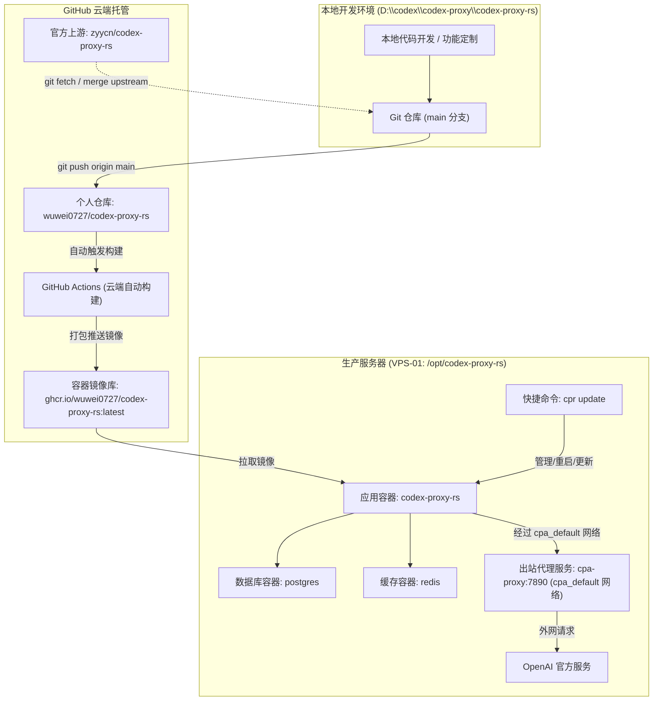
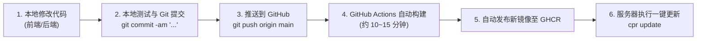
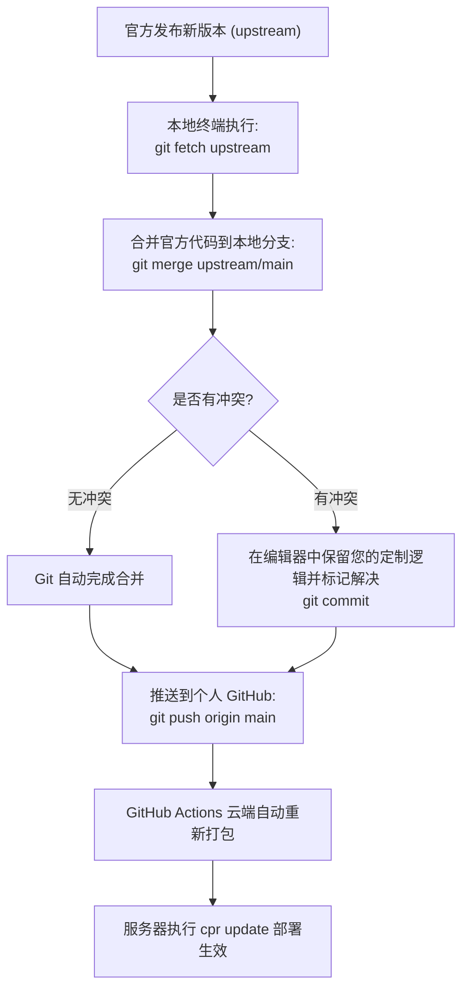

# Codex Proxy RS 二次开发与运维部署维护手册

> 本手册记录了 Codex Proxy RS 的定制化开发、云端自动化构建、服务器部署运维、官方版本同步升级以及常见故障排查全流程，供日后长期维护参考。

---

## 一、 系统架构与部署拓扑



### 1. 核心资产与路径对照

| 资产类型 | 地址 / 路径 / 标识 | 说明 |
| :--- | :--- | :--- |
| **本地代码路径** | `D:\codex\codex-proxy\codex-proxy-rs` | 本地源码工程及开发环境 |
| **个人远程仓库 (origin)** | `git@github.com:wuwei0727/codex-proxy-rs.git` | 存放个人定制代码与专属构建脚本 |
| **官方上游仓库 (upstream)** | `https://github.com/zyycn/codex-proxy-rs.git` | 官方原始发布与更新源 |
| **专属 Docker 镜像** | `ghcr.io/wuwei0727/codex-proxy-rs:latest` | 由 GitHub Actions 云端自动打包的生产镜像 |
| **生产服务器** | `VPS-01` | 部署运行实例的远程服务器 |
| **服务器部署目录** | `/opt/codex-proxy-rs/deploy` | 生产环境 Docker Compose 运行目录 |
| **服务器运行时数据** | `/opt/codex-proxy-rs/.runtime` | 数据库、Redis、日志及应用数据的持久化根目录 |
| **全局管理命令** | `/usr/local/bin/cpr` (软链接至 `cpa`) | 生产服务器日常运维快捷管理工具 |

---

## 二、 核心工作流一：二次开发与自动发布部署

当您在本地开发了新功能（例如优化表格、账号脱敏、界面调整或业务扩展），上线流程全程自动化，无需在本地消耗电脑性能编译 Rust 和前端。



### 详细操作步骤

#### 1. 本地修改与提交
在本地 `D:\codex\codex-proxy\codex-proxy-rs` 完成代码编写后，提交并推送到您自己的 GitHub：
```bash
git add .
git commit -m "feat: 增加自定义功能描述"
git push origin main
```

#### 2. 云端自动打包镜像
推送成功后，GitHub 会自动启动名为 **Build & Push Docker Image** 的工作流：
* 自动提取当前版本号与 Git 提交哈希；
* 先构建前端与组件库（`modules/ui` 与 `frontend`）；
* 编译高性能 Rust 后端二进制；
* 生成符合安全规范的官方插件清单文件；
* 打包并推送到 `ghcr.io/wuwei0727/codex-proxy-rs:latest`。

可以在 GitHub 仓库页面的 `Actions` 标签页查看打包进度。

#### 3. 服务器一键更新生效
镜像打包完成后，连接到服务器执行：
```bash
cpr update
```
该命令会自动完成：
1. 从 `ghcr.io` 拉取您最新的专属镜像；
2. 平滑重建并启动 `codex-proxy-rs` 容器；
3. 执行增量数据库迁移；
4. 恢复代理网络连通；
5. 检查容器健康状态并展示更新结果。

---

## 三、 核心工作流二：同步并合并官方最新版本

当官方发布了新版本（修了漏洞、支持了新的模型或新增了特性）时，您需要将官方代码合并到您的定制代码中。

> [!CAUTION]
> **切勿在网页管理面板直接点击“系统更新 / 在线更新”！**
> 网页上的“在线更新”会直接下载官方预编译好的程序原地覆盖，**这会瞬间将您自己编写的所有定制代码全部抹掉**！
> 正确的做法是使用 Git 进行代码合并。



### 详细操作步骤

#### 1. 确保本地工作区干净
```bash
cd D:\codex\codex-proxy\codex-proxy-rs
git status
```

#### 2. 拉取官方最新代码
```bash
git fetch upstream
```

#### 3. 将官方改动合并到本地 `main` 分支
```bash
git checkout main
git merge upstream/main
```
* **如果无冲突**：Git 会直接自动合并并生成一条合并提交。
* **如果有冲突**：编辑器（如 VS Code）会高亮标出冲突文件。只需确认保留您修改的部分（如界面展示、特定逻辑），保存文件后执行：
  ```bash
  git add .
  git commit -m "merge: 同步官方上游最新改动"
  ```

#### 4. 推送到 GitHub 并自动发布
```bash
git push origin main
```
云端会自动编译并打包包含了“官方新功能 + 您自己的定制功能”的最新镜像。

#### 5. 服务器更新生效
在服务器终端运行：
```bash
cpr update
```

---

## 四、 生产服务器部署与运维配置规范

### 1. 服务器运行目录结构
```text
/opt/codex-proxy-rs/
├── deploy/                      # 部署控制目录
│   ├── compose.yaml             # Docker Compose 主配置文件
│   ├── config.yaml              # 应用程序全局业务配置文件
│   └── .env                     # 环境变量（镜像源、数据库凭证等）
└── .runtime/                    # 持久化运行时数据
    ├── data/                    # 应用数据与 SQLite/Token 状态
    ├── logs/                    # 业务运行日志
    ├── postgres/                # PostgreSQL 数据目录
    └── redis/                   # Redis 持久化数据
```

### 2. 核心网络连通机制（避免“服务商暂不可用”）
为了确保 `codex-proxy-rs` 容器能够访问宿主机上运行的出站代理（`http://cpa-proxy:7890/`），`compose.yaml` 中配置了接入外部 Docker 网络：

```yaml
networks:
  default:
  cpa_default:
    external: true
```

* **作用**：让 `codex-proxy-rs` 容器内部的 DNS 能够直接解析 `cpa-proxy` 这一域名，从而成功将出站请求转发至代理客户端（Clash/Sing-box 等），顺利连通 OpenAI 官方接口。

### 3. 全局管理命令速查（`cpr` 工具）

在服务器任意目录下均可直接调用 `cpr` 命令：

| 命令 | 说明 | 典型使用场景 |
| :--- | :--- | :--- |
| `cpr status` | 查看所有组件的运行与健康状态 | 检查服务是否正常启动 |
| `cpr logs` | 查看网关主程序最新实时日志 | 排查请求失败或接口错误 |
| `cpr logs app` | 持续跟踪网关服务输出 | 调试请求转发过程 |
| `cpr logs db` | 查看 PostgreSQL 数据库日志 | 排查数据库迁移或连接问题 |
| `cpr restart` | 安全平滑重启服务 | 修改了 `config.yaml` 配置文件后 |
| `cpr update` | 拉取最新专属镜像并平滑更新 | GitHub Actions 打包完成后升级系统 |
| `cpr backup` | 创建数据库与配置全量备份 | 重大改动或升级前的安全保护 |
| `cpr config` | 校验配置文件的语法有效性 | 修改配置后自检 |

---

## 五、 关键排错与避坑指南 (FAQ)

### 问题 1：账号详情弹窗点击“刷新信息”报“失败 服务商暂不可用”

* **现象**：在“账号管理”中点击账号打开“个人信息”弹窗，点击右下角“刷新信息”按钮，右上角弹出红色提示“失败 服务商暂不可用”，连续天数等字段显示 `-`。
* **原因剖析**：
  * 该弹窗查询的是 OpenAI 官方针对原版官方桌面端（Codex Desktop）的打卡与累计统计，对应内部私有接口：`GET /backend-api/wham/profiles/me`。
  * 该账号若从未在原版官方桌面客户端登录并生成过桌面档案，或者该私有接口受到网络质询，接口返回非 200，系统会安全回退并提示服务商暂不可用。
* **结论与影响**：
  * **完全不影响任何实际业务！**
  * 实际的模型对话、流式输出、Token 计费走的是独立的核心转发链路。只要账号状态为 `ready` 且服务器日志显示 `outcome: succeeded`，日常对话完全正常。

### 问题 2：系统更新页面提示“异常: 安装文件不完整，请核对部署后重试”

* **现象**：打开系统概览中的“系统更新”卡片，显示红色警告“异常 安装文件不完整，请核对部署后重试”。
* **原因剖析**：
  * 系统更新校验逻辑（`installation.rs`）要求同时存在三项：
    1. 主程序：`/app/bin/codex-proxy-rs`
    2. 前端页面：`/app/web/dist/index.html`
    3. 官方插件清单：`/app/bin/plugins/official/plugin-release-manifest.json`
  * 原始 Dockerfile 在源码编译阶段遗漏了创建该清单文件，导致校验判定文件缺失。
* **解决方案**：
  * 已在 `deploy/Dockerfile` 的 `runtime` 阶段内建了自动生成合法封口清单（`plugin-release-manifest.json`）并赋予只读权限的代码。
  * 经由 GitHub Actions 自动打出的新镜像天生自带该清单，更新后该报错彻底消除。

### 问题 3：容器出站请求失败 / 账号全部显示不可用

* **排查顺序**：
  1. 运行 `cpr logs` 查看是否有 `Connection refused` 或 `proxy connection failed` 报错；
  2. 检查 `compose.yaml` 中是否挂载了 `cpa_default` 外部网络；
  3. 确认服务器宿主机上的代理服务容器（`cpa-proxy`）是否处于运行状态：
     ```bash
     docker ps | grep proxy
     ```
  4. 检查账号管理中的出站代理地址是否为：`http://cpa-proxy:7890/`。

---

## 六、 维护备忘清单

- [ ] 本地开发使用分支或直接在 `main` 维护，提交时撰写清晰的提交说明；
- [ ] 涉及大版本升级前，在服务器运行一次 `cpr backup` 确保数据随时可回滚；
- [ ] 代码推送到 GitHub 后，先在 GitHub Actions 页面确认构建变绿（绿勾），再前往服务器运行 `cpr update`；
- [ ] 严禁在 Web 界面点击官方在线更新，所有更新统一走 GitHub CI/CD 与 `cpr update`。
