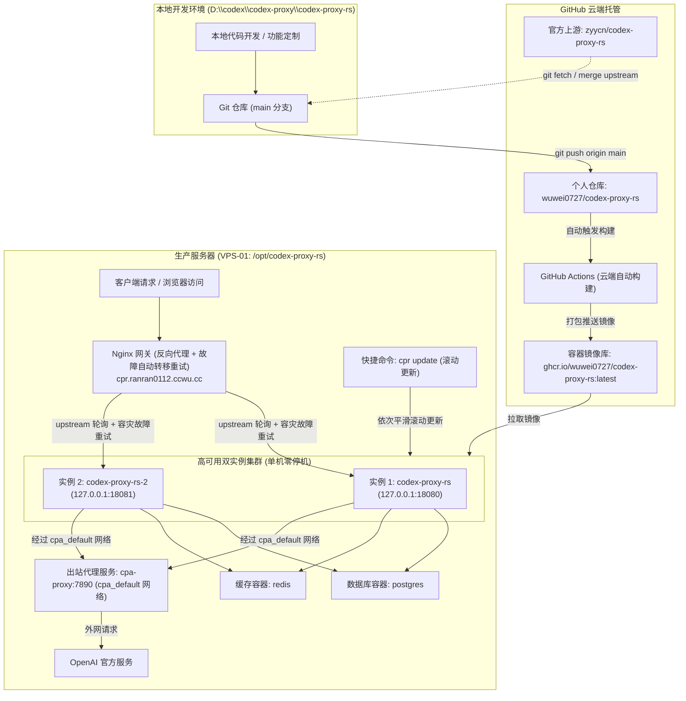
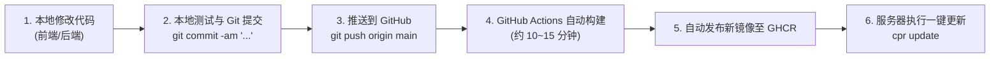
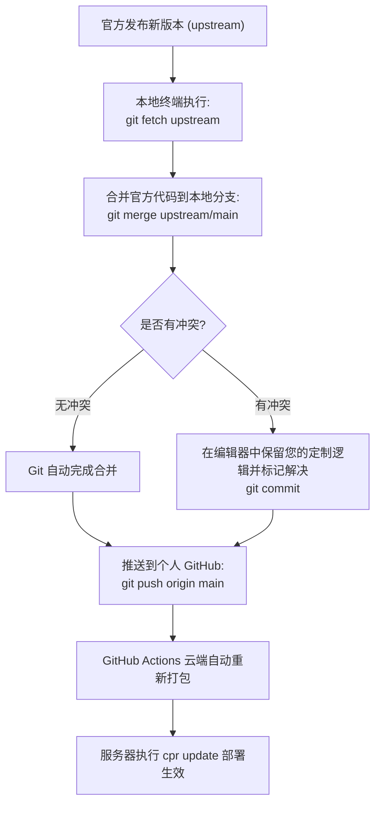
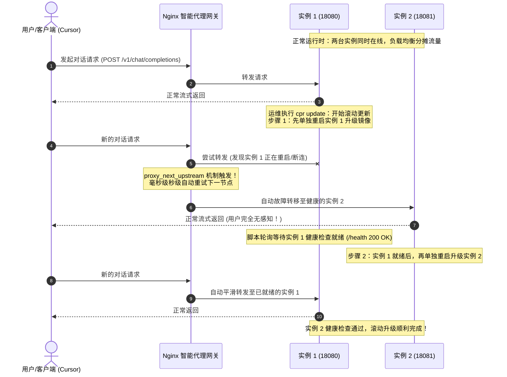

# Codex Proxy RS 二次开发与运维部署维护手册

> 本手册记录了 Codex Proxy RS 的定制化开发、云端自动化构建、服务器部署运维、官方版本同步升级以及常见故障排查全流程，供日后长期维护参考。

---

## 一、 系统架构与部署拓扑



### 1. 核心资产与路径对照

| 资产类型 | 地址 / 路径 / 标识 | 说明 |
| :--- | :--- | :--- |
| **本地代码路径** | `D:\codex\codex-proxy\codex-proxy-rs` | 本地源码工程及开发环境 |
| **个人远程仓库 (origin)** | `git@github.com:wuwei0727/codex-proxy-rs.git` | 存放个人定制代码与专属构建脚本 |
| **官方上游仓库 (upstream)** | `https://github.com/zyycn/codex-proxy-rs.git` | 官方原始发布与更新源 |
| **专属 Docker 镜像** | `ghcr.io/wuwei0727/codex-proxy-rs:latest` | 由 GitHub Actions 云端自动打包的生产镜像 |
| **生产服务器** | `VPS-01` (`179.255.156.3`) | 部署运行实例的远程服务器 |
| **Nginx 站点配置** | `/etc/nginx/sites-available/cpr.ranran0112.ccwu.cc` | 配置反向代理集群与故障自动转移重试 |
| **集群上游端口** | `127.0.0.1:18080` / `127.0.0.1:18081` | 实例 1 (`codex-proxy-rs`) 与实例 2 (`codex-proxy-rs-2`) |
| **服务器部署目录** | `/opt/codex-proxy-rs/deploy` | 生产环境 Docker Compose 运行目录 |
| **服务器运行时数据** | `/opt/codex-proxy-rs/.runtime` | 数据库、Redis、日志及应用数据的持久化根目录 |
| **全局管理命令** | `/usr/local/bin/cpr` (软链接至 `cpa`) | 生产服务器日常运维快捷管理工具（支持零停机滚动更新） |

---

## 二、 核心工作流一：二次开发与自动发布部署

当您在本地开发了新功能（例如优化表格、账号脱敏、界面调整或业务扩展），上线流程全程自动化，无需在本地消耗电脑性能编译 Rust 和前端。



### 详细操作步骤

#### 1. 本地修改与提交
在本地 `D:\codex\codex-proxy\codex-proxy-rs` 完成代码编写后，提交并推送到您自己的 GitHub：
```bash
git add .
git commit -m "feat: 增加自定义功能描述"
git push origin main
```

#### 2. 云端自动打包镜像
推送成功后，GitHub 会自动启动名为 **Build & Push Docker Image** 的工作流：
* 自动提取当前版本号与 Git 提交哈希；
* 先构建前端与组件库（`modules/ui` 与 `frontend`）；
* 编译高性能 Rust 后端二进制；
* 生成符合安全规范的官方插件清单文件；
* 打包并推送到 `ghcr.io/wuwei0727/codex-proxy-rs:latest`。

可以在 GitHub 仓库页面的 `Actions` 标签页查看打包进度。

#### 3. 服务器一键无感知滚动更新
镜像打包完成后，连接到服务器执行：
```bash
cpr update
```
> [!TIP]
> **零停机升级保障**：系统采用“双实例交替滚动更新（Rolling Update）”机制。更新时会自动先更新实例 1（`codex-proxy-rs`），此时 Nginx 将所有外部流量自动转发给在线的实例 2；待实例 1 健康检查通过就绪后，再自动更新实例 2。整个升级过程用户正在进行的模型调用和界面访问完全不中断、不报错。

该命令会自动完成：
1. 从 `ghcr.io` 拉取最新的专属镜像；
2. 依次平滑滚动重启更新 `codex-proxy-rs` 与 `codex-proxy-rs-2`；
3. 执行增量数据库迁移；
4. 确保出站网络 `cpa_default` 挂载完好；
5. 自动进行本地健康检查检测，确保更新成功并输出集群状态。

---

## 三、 核心工作流二：同步并合并官方最新版本

当官方发布了新版本（修了漏洞、支持了新的模型或新增了特性）时，您需要将官方代码合并到您的定制代码中。

> [!CAUTION]
> **切勿在网页管理面板直接点击“系统更新 / 在线更新”！**
> 网页上的“在线更新”会直接下载官方预编译好的程序原地覆盖，**这会瞬间将您自己编写的所有定制代码全部抹掉**！
> 正确的做法是使用 Git 进行代码合并。



### 详细操作步骤

#### 1. 确保本地工作区干净
```bash
cd D:\codex\codex-proxy\codex-proxy-rs
git status
```

#### 2. 拉取官方最新代码
```bash
git fetch upstream
```

#### 3. 将官方改动合并到本地 `main` 分支
```bash
git checkout main
git merge upstream/main
```
* **如果无冲突**：Git 会直接自动合并并生成一条合并提交。
* **如果有冲突**：编辑器（如 VS Code）会高亮标出冲突文件。只需确认保留您修改的部分（如界面展示、特定逻辑），保存文件后执行：
  ```bash
  git add .
  git commit -m "merge: 同步官方上游最新改动"
  ```

#### 4. 推送到 GitHub 并自动发布
```bash
git push origin main
```
云端会自动编译并打包包含了“官方新功能 + 您自己的定制功能”的最新镜像。

#### 5. 服务器更新生效
在服务器终端运行：
```bash
cpr update
```

---

## 四、 生产服务器部署与运维配置规范

### 1. 服务器运行目录结构
```text
/opt/codex-proxy-rs/
├── deploy/                      # 部署控制目录
│   ├── compose.yaml             # Docker Compose 主配置文件
│   ├── config.yaml              # 应用程序全局业务配置文件
│   └── .env                     # 环境变量（镜像源、数据库凭证等）
└── .runtime/                    # 持久化运行时数据
    ├── data/                    # 应用数据与 SQLite/Token 状态
    ├── logs/                    # 业务运行日志
    ├── postgres/                # PostgreSQL 数据目录
    └── redis/                   # Redis 持久化数据
```

### 2. 核心网络连通机制（避免“服务商暂不可用”）
为了确保 `codex-proxy-rs` 容器能够访问宿主机上运行的出站代理（`http://cpa-proxy:7890/`），`compose.yaml` 中配置了接入外部 Docker 网络：

```yaml
networks:
  default:
  cpa_default:
    external: true
```

* **作用**：让 `codex-proxy-rs` 容器内部的 DNS 能够直接解析 `cpa-proxy` 这一域名，从而成功将出站请求转发至代理客户端（Clash/Sing-box 等），顺利连通 OpenAI 官方接口。

### 3. 单机双实例零停机平滑滚动更新高可用架构（Zero-Downtime）

#### 背景与痛点
在单容器架构下，每次执行版本升级或重启服务时，Docker 都需要停止旧容器并启动新容器，中间通常存在 **15~30 秒的服务不可用真空期**。在此期间如果有用户正在使用 Cursor、VS Code 插件或 API 发起长文本对话，会导致请求直接报 `502 Bad Gateway` 并中断，非常影响用户体验。

为此，生产服务器现已升级为**单机双实例 + Nginx 智能故障转移 + 自动滚动更新**的高可用架构。

#### 架构三要素与实现原理



1. **Docker Compose 双实例部署 (`deploy/compose.yaml`)**
   - 容器 1：`codex-proxy-rs`（映射宿主机 `127.0.0.1:18080:8080`）
   - 容器 2：`codex-proxy-rs-2`（映射宿主机 `127.0.0.1:18081:8080`）
   - **资源开销**：单实例日常仅消耗约 100MB 内存，双实例仅需约 200MB，在 2GB 内存的 VPS 上运行非常轻松且稳定。
   - **数据一致性**：两实例共享同一套 PostgreSQL 数据库连接、Redis 缓存与本地持久化目录（Token 状态完全互通）。

2. **Nginx 反向代理集群与毫秒级故障自动转移 (`/etc/nginx/sites-available/cpr.ranran0112.ccwu.cc`)**
   - **集群上游定义**：
     ```nginx
     upstream cpr_cluster {
         server 127.0.0.1:18080 max_fails=2 fail_timeout=10s;
         server 127.0.0.1:18081 max_fails=2 fail_timeout=10s;
         keepalive 32;
     }
     ```
   - **容灾转移核心参数**：
     ```nginx
     location / {
         proxy_pass http://cpr_cluster;
         # 当上游遇到连接错误、超时、502、503 时，毫秒级无缝重试集群中的另一台可用机器
         proxy_next_upstream error timeout invalid_header http_502 http_503;
         proxy_next_upstream_tries 3;
         proxy_next_upstream_timeout 10s;
         ...
     }
     ```
   - **效果**：哪怕其中一个实例由于更新、崩溃或 OOM 退出，Nginx 都会自动将请求重试给另一个实例，外部用户永远不会收到 502 报错。

3. **自动化滚动更新算法 (`deploy/cpr.sh`)**
   - 执行 `cpr update` 时，脚本会自动执行安全有序的滚动更新流程：
     1. 从远端拉取最新镜像；
     2. 单独重启并更新实例 1（`codex-proxy-rs`）；
     3. 自动发起 HTTP 健康探活循环，轮询 `http://127.0.0.1:18080/` 或 `/health`，直到确认实例 1 成功启动并返回正常状态码；
     4. 确认实例 1 恢复服务后，再单独重启并更新实例 2（`codex-proxy-rs-2`）；
     5. 轮询确认实例 2 健康检查通过；
     6. 重载 Nginx 代理配置，输出双实例正常运行状态。

### 4. 全局管理命令速查（`cpr` 工具）

在服务器任意目录下均可直接调用 `cpr` 命令：

| 命令 | 说明 | 典型使用场景 |
| :--- | :--- | :--- |
| `cpr status` | 查看所有组件的运行与健康状态（含双实例） | 检查双实例及数据库是否正常运行 |
| `cpr update` | **零停机滚动更新**至最新镜像 | GitHub Actions 构建完成后一键升级（用户无感知） |
| `cpr rolling-update` | 手动显式触发双实例滚动更新 | 同 `cpr update` |
| `cpr restart` | 平滑重启应用实例 | 调整了 `config.yaml` 或环境变量后生效 |
| `cpr logs` | 查看主实例最新实时日志 | 排查请求失败或接口错误 |
| `cpr logs app` | 持续跟踪实例 1 日志输出 | 实时监控业务流 |
| `cpr logs app2` | 持续跟踪实例 2 日志输出 | 监控第二实例运行情况 |
| `cpr logs db` | 查看 PostgreSQL 数据库日志 | 排查数据库迁移或连接问题 |
| `cpr backup` | 创建数据库与配置全量备份 | 重大改动或升级前的安全保护 |
| `cpr config` | 校验配置文件的语法有效性 | 修改配置后自检 |

---

## 五、 关键排错与避坑指南 (FAQ)

### 问题 1：账号详情弹窗点击“刷新信息”报“失败 服务商暂不可用”

* **现象**：在“账号管理”中点击账号打开“个人信息”弹窗，点击右下角“刷新信息”按钮，右上角弹出红色提示“失败 服务商暂不可用”，连续天数等字段显示 `-`。
* **原因剖析**：
  * 该弹窗查询的是 OpenAI 官方针对原版官方桌面端（Codex Desktop）的打卡与累计统计，对应内部私有接口：`GET /backend-api/wham/profiles/me`。
  * 该账号若从未在原版官方桌面客户端登录并生成过桌面档案，或者该私有接口受到网络质询，接口返回非 200，系统会安全回退并提示服务商暂不可用。
* **结论与影响**：
  * **完全不影响任何实际业务！**
  * 实际的模型对话、流式输出、Token 计费走的是独立的核心转发链路。只要账号状态为 `ready` 且服务器日志显示 `outcome: succeeded`，日常对话完全正常。

### 问题 2：系统更新页面提示“异常: 安装文件不完整，请核对部署后重试”

* **现象**：打开系统概览中的“系统更新”卡片，显示红色警告“异常 安装文件不完整，请核对部署后重试”。
* **原因剖析**：
  * 系统更新校验逻辑（`installation.rs`）要求同时存在三项：
    1. 主程序：`/app/bin/codex-proxy-rs`
    2. 前端页面：`/app/web/dist/index.html`
    3. 官方插件清单：`/app/bin/plugins/official/plugin-release-manifest.json`
  * 原始 Dockerfile 在源码编译阶段遗漏了创建该清单文件，导致校验判定文件缺失。
* **解决方案**：
  * 已在 `deploy/Dockerfile` 的 `runtime` 阶段内建了自动生成合法封口清单（`plugin-release-manifest.json`）并赋予只读权限的代码。
  * 经由 GitHub Actions 自动打出的新镜像天生自带该清单，更新后该报错彻底消除。

### 问题 3：容器出站请求失败 / 账号全部显示不可用

* **排查顺序**：
  1. 运行 `cpr logs` 查看是否有 `Connection refused` 或 `proxy connection failed` 报错；
  2. 检查 `compose.yaml` 中是否挂载了 `cpa_default` 外部网络；
  3. 确认服务器宿主机上的代理服务容器（`cpa-proxy`）是否处于运行状态：
     ```bash
     docker ps | grep proxy
     ```
  4. 检查账号管理中的出站代理地址是否为：`http://cpa-proxy:7890/`。

---

## 六、 维护备忘清单

- [ ] 本地开发使用分支或直接在 `main` 维护，提交时撰写清晰的提交说明；
- [ ] 涉及大版本升级前，在服务器运行一次 `cpr backup` 确保数据随时可回滚；
- [ ] 代码推送到 GitHub 后，先在 GitHub Actions 页面确认构建变绿（绿勾），再前往服务器运行 `cpr update` 执行零停机滚动更新；
- [ ] 升级后运行 `cpr status`，确认主实例与第二实例（`codex-proxy-rs-2`）均处于正常健康运行状态；
- [ ] 严禁在 Web 界面点击官方在线更新，所有更新统一走 GitHub CI/CD 与 `cpr update`。
